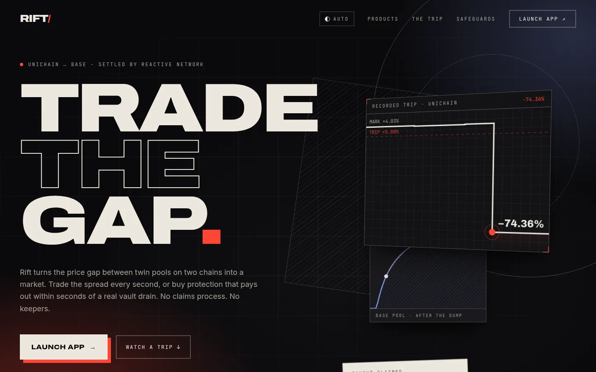
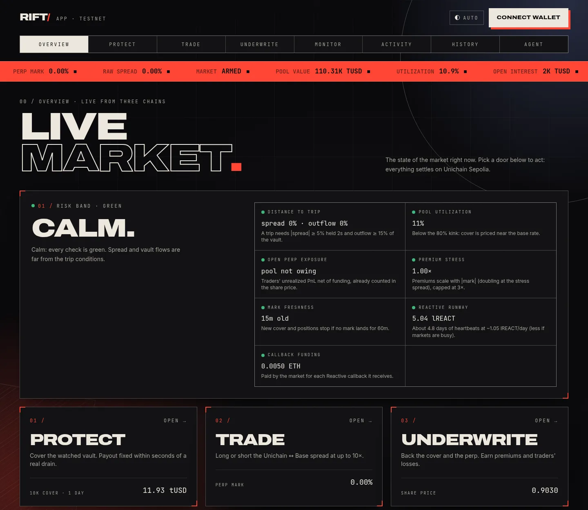
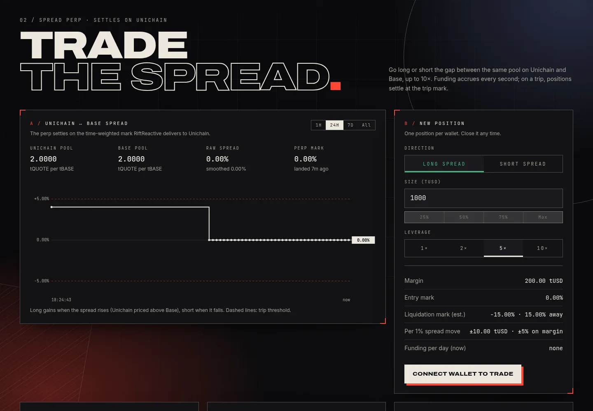
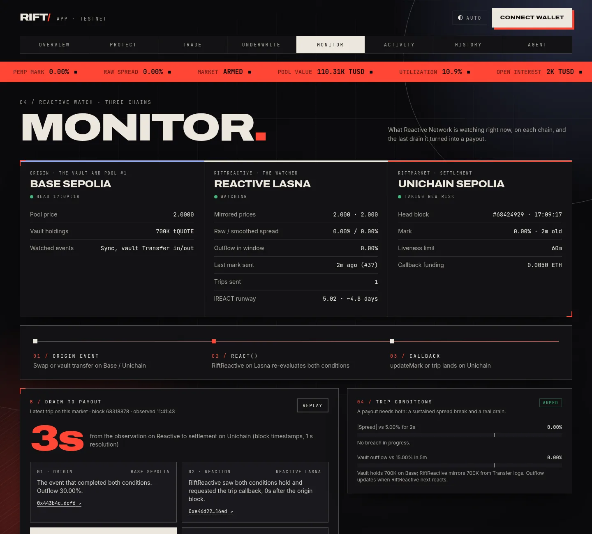
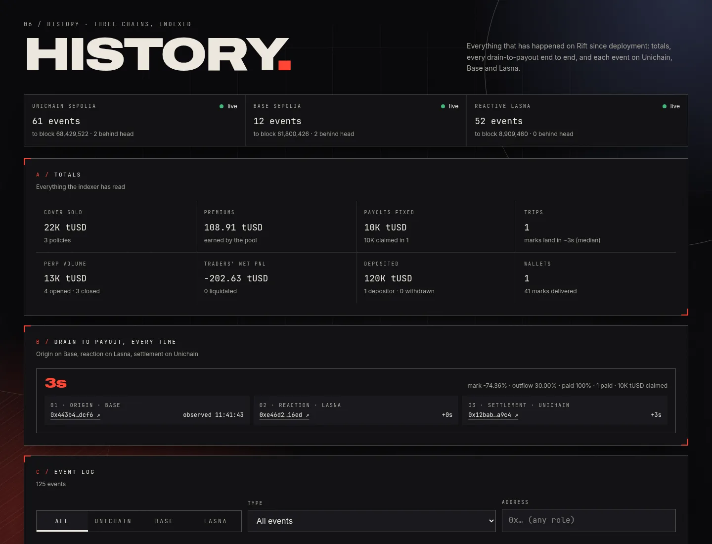
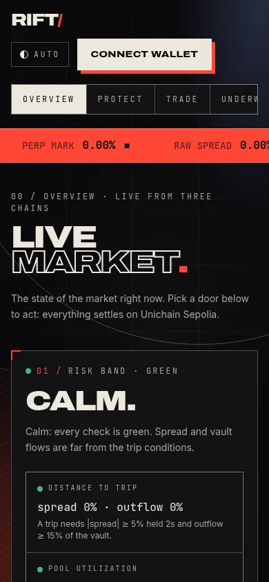
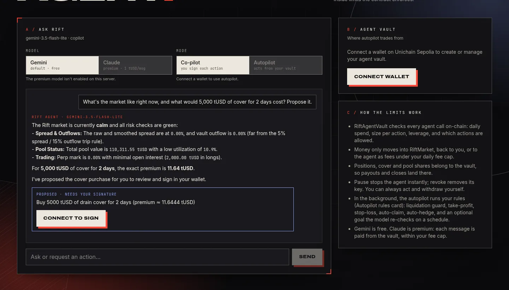

<h1>
  <picture>
    <source media="(prefers-color-scheme: dark)" srcset="docs/images/logo-dark.png">
    
  </picture>
</h1>

**Trade the gap between chains.** Cross-chain spread perps and instant drain protection on Unichain Sepolia and Base Sepolia, settled by a Reactive Omni contract. No oracles, no keepers.

Built for the [Reactive Omni Buildathon](https://dorahacks.io/hackathon/reactive-omni-buildathon/detail) (track: *Every Second Counts*).

**Live app:** [rift-bice.vercel.app](https://rift-bice.vercel.app) (testnet).

**Videos:** [69 s pitch](brag-output/rift-pitch.mp4) (the Nomad story, how a trip works, the testnet run and the replay) · [25 s teaser](brag-output/brag.mp4).

**The use case it's built for: bridge-failure cover.** When a bridge is drained, the tokens it minted on other chains lose their backing and crash below the originals, and holders can't sell their way out. Rift watches the bridge's escrow and the bridged token's price, and when both break it fixes every covered payout in one transaction, seconds later, from a pool funded in advance. Replayed on the 2022 Nomad exploit, Rift trips while $71.2M of the $87.5M USDC escrow is still there ([replay](#replay-the-nomad-bridge-exploit-2022)).



## The idea

The same pool runs on two chains, and their prices should agree. When they don't, the gap (the **spread**) is information:

- Small, everyday gaps are normal market drift, so Rift lets people **trade** them (spread perp, funding every second).
- A sudden, sustained gap together with money leaving a vault is what an exploit looks like, so Rift sells **protection** against it (Drain Default Swap) and pays out within seconds of the drain.

Both products run off **one index**: the spread computed by `RiftReactive`. One pool of underwriters backs both.

| Leg | Product | Settles on |
|---|---|---|
| Continuous | Spread perp: long/short the Unichain-vs-Base spread in bps | every `updateMark` callback |
| Jump | Drain Default Swap: pay a premium, receive `notional` if the vault is drained | the `trip` callback fixes every payout; buyers `claim()` it |

## The use case: when a bridge breaks

A bridge holds tokens in an escrow on one chain and mints copies of them on others. The copies are only worth what the escrow still holds. When the escrow is drained, the copies collapse, and they collapse faster than anyone can react: in the Nomad exploit, bridged USDC on Moonbeam fell to 4.5 cents on the dollar before a single USDC had left the escrow on Ethereum.

That event shows up exactly as Rift's two conditions:

- **Outflow:** the bridge's escrow (the watched vault) loses a large share of its balance within minutes.
- **Spread:** the bridged copy trades far below the original. Its twin market is the original token's own market, so the spread *is* the holders' loss.

Who it serves:

- **Holders of bridged assets** (DAO treasuries, LPs, funds on the destination chain) buy cover sized to what they hold. When the bridge fails, the payout is fixed in the trip transaction and claimable right away. No claims assessment, no vote, no waiting for a post-mortem.
- **Underwriters** earn premiums for carrying bridge risk, priced by how much cover is outstanding and by how stressed the spread already is.
- **Traders and market makers** use the spread perp to hedge bridged inventory or to take a view on a bridge's health, from one chain, without bridging anything themselves.
- **Bridges and protocols** can buy cover for their own users, or offer it at deposit time.

## Replay: the Nomad bridge exploit (2022)

To check the rule against reality, [`research/nomad-replay.mjs`](research/nomad-replay.mjs) rebuilds the Nomad exploit from chain history alone (public archive RPCs, no third-party data) and applies Rift's default trip rule to cover on Nomad-bridged USDC:

- **Vault:** Nomad's ERC20 bridge escrow on Ethereum ([`0x88A6…30A3`](https://etherscan.io/address/0x88A69B4E698A4B090DF6CF5Bd7B2D47325Ad30A3)), its USDC balance.
- **Twin market:** Nomad-bridged USDC on Moonbeam, priced through a stable-swap pool against FRAX (not Nomad-bridged, so it stays near $1).
- **Rule:** spread ≤ −5% **and** ≥ 15% of the escrow's balance out within 5 minutes, both at once.

| Time (UTC, 1 Aug 2022) | |
|---|---|
| 21:32:31 | First exploit transaction: WBTC leaves the escrow ([block 15259101](https://etherscan.io/block/15259101)) |
| 22:29:12 | Bridged USDC on Moonbeam trades at **0.045**: a 95% depeg, 9 minutes before any USDC has left the escrow |
| 22:38:23 | First USDC leaves the escrow |
| **22:46:36** | **Rift trips**: 16% of the USDC escrow gone in 5 minutes, bridged USDC at −98%. **$71.2M of $87.5M is still in the escrow** |
| 23:52:05 | Last USDC leaves; the escrow is empty |

What it shows:

- **The rule fires on a real exploit**, 8 minutes after the USDC drain starts and 65 minutes before it ends.
- **Selling out was not an option.** The bridged token lost 95% of its value within an hour of the first exploit transaction, before the USDC drain even began, and the pool's exit price fell to about 2 cents. A fast warning alone wouldn't have saved holders; a payout fixed by a pre-funded pool would have.
- **The two conditions did their job.** The price crashed first (the attack had already been draining other tokens for an hour); the trip waited until the watched escrow itself was being drained.

Limits of the replay: one destination pool, sampled every ~1 minute (Moonbeam's 12 s blocks); FRAX as the stand-in for par; the time-weighted mark and the 2 s sustain check are not simulated (at a 95%+ gap they don't change the outcome). Whether the pool could have *paid* depends on how much capital underwriters had committed, which is a sizing question, not a detection one. Raw results: [`research/nomad-replay.json`](research/nomad-replay.json); every token's outflow timing: [`research/nomad-outflow.json`](research/nomad-outflow.json).

## Why it needs Reactive Omni

- The signal lives on **two chains** (the twin markets, and the vault on one of them). No single contract can see both, so `RiftReactive` is the only thing that connects them.
- Payout speed is the product. Cover that pays weeks later, after a claims process, arrives when the damage is long done. Rift fixes every payout in the trip callback, about a second after the condition holds. As the replay shows, the market for the broken asset is gone within minutes, so a fixed payout from a pool funded in advance is what holders can actually rely on.

## Architecture

```
 Base Sepolia (84532)                Reactive Lasna                       Unichain Sepolia (1301)
 ┌───────────────┐  Sync         ┌──────────────────────┐   updateMark   ┌──────────────────────┐
 │ RiftPool (B)  │──────────────▶│                      │───────────────▶│ RiftMarket           │
 └───────────────┘               │    RiftReactive      │                │  · underwriting pool │
 ┌───────────────┐  Transfer     │  · mirrors prices    │      trip      │  · drain protection  │
 │ MockVault     │──(in / out)──▶│  · spread (bps)      │───────────────▶│  · spread perp       │
 └───────────────┘               │  · outflow window    │                └──────────────────────┘
                                 │  · trip rule         │                ┌──────────────────────┐
                    Sync         │                      │◀───────────────│ RiftPool (U)         │
                                 └──────────────────────┘                └──────────────────────┘
```

### The trip rule (anti-manipulation)

`trip()` fires only when **both** of these are true:

1. `|spread| ≥ tripSpreadBps` **for at least** `sustainSeconds` (timed on Reactive's clock), **and**
2. vault outflow inside `windowSeconds` ≥ `tripOutflowBps` of the vault.

A price spike alone (someone pushing a thin pool to collect on protection) can't trip it, and neither can a large legitimate withdrawal alone. Both cases are covered by tests. All timers use timestamps, never block counts (Base Sepolia runs 200ms blocks).

### Settlement safeguards

- **Cover waiting period.** A drain is public on Base seconds before the trip lands on Unichain. A policy covers nothing until `coverDelay` (default 10 minutes, owner-settable up to 1 hour) after purchase; the delay is fixed on the policy when it's bought. At a trip, policies still waiting are refunded their premium instead of paid, and they don't dilute the payout ratio of covered buyers. Timing is checked against the trip's `observedAt` on Reactive's clock.
- **Claim-based payouts.** `trip()` makes no token transfers: it records what each policy is owed (`PolicySettled`), and `claim(id)` pays it. Anyone can call `claim`, but funds always go to the buyer. A buyer who can't receive tokens (for example a blocklisted address) can't make the trip revert for everyone else.
- **Trip retry with confirmation.** RiftReactive subscribes to the market's own `Tripped` event on Unichain. Until it sees it, every later event re-sends the same trip, at most every `TRIP_RETRY_SECONDS` (30 s). `trip()` is idempotent, so duplicates are harmless.
- **Out-of-order marks.** `updateMark` ignores a mark observed earlier than the current one and emits `StaleMarkIgnored`.

### Perp mark hardening

The trip already needs a real drain, but the perp mark comes straight from pool prices, so it gets its own defences in RiftReactive:

- **Time-weighted mark.** The mark sent to the perp is a continuous-time moving average of the spread (`markSmoothingSeconds`, default 30 s). Each spread is weighted by how long it actually held, so a price pushed and put back within one Reactive second moves the mark by nothing, and a move has to persist to reach the mark. The trip still uses the raw spread, because the trip settles at the crash level, and the outflow condition already guards it.
- **Thin-pool guard.** A `Sync` whose token1 reserve is below `minQuoteReserve` is ignored, and the pool's last good price is kept (`ThinPoolIgnored`).

### Premium pricing

A flat premium sells cover cheaply exactly when it's most dangerous: when the pool is nearly fully committed, or when the spread already shows stress. It also lets anyone buy up all the capacity cheaply and lock other buyers out. So the premium responds to both:

- **Utilization curve.** The daily rate for the marginal unit of cover depends on utilization `u` (live notional / capacity). It rises gently up to a kink (default: 0.10%/day idle, 0.20%/day at 80%) and steeply after it (2.20%/day at 100%).
- **Priced as a cost function.** A purchase pays the area under the rate curve from the utilization before it to the utilization after it, times duration. That's the LMSR idea applied to pool capacity: the price depends only on where you start and end, so splitting an order into pieces costs the same as buying it at once (a fuzz test checks this). Capacity is pool cash *minus the premiums of live policies*, so a purchase's own premium doesn't make the next slice cheaper.
- **Stress loading.** The premium is multiplied by `1 + |mark| / stressSpreadBps` (default 500 bps, the trip threshold), capped at 3x. Cover bought while the spread is already wide costs more.
- `quotePremium(notional, duration)` returns the exact price; `premiumRateBpsPerDay(u)`, `utilizationWad()` and `stressMultiplierBps()` expose the parts. The owner can tune the curve with `setPremiumParams` within hard bounds (each term ≤ 10%/day, kink strictly between 0 and 100%).

Example on a 100k pool with no stress: the first 10k of one-day cover costs 10.63, and the last 10k (90% → 100%) costs 170, about 16x as much.

### Underwriting accounting

- **Shares priced at pool value.** `deposit` and `completeWithdraw` price shares at `poolValue()`: the pool's cash minus traders' unrealized perp PnL net of funding (`tradersUnrealizedPnl()`). A newcomer can't buy into gains the pool hasn't realized yet, and a leaver can't exit before a loss lands. The total comes from running sums of open positions (size × entry mark, size × entry funding), so it costs the same however many positions are open. Rounding always favours the holders who stay.
- **Two-step withdrawals.** `requestWithdraw` locks shares, and `completeWithdraw` pays them out after `WITHDRAW_DELAY` (1 h) at the pool value at that moment. Locked shares stay in the pool, so they still pay for a trip that lands during the wait. An underwriter who sees a drain on Base can't get out first. `cancelWithdraw` unlocks them.
- **Liquidation reward.** `liquidate` pays the caller up to `LIQUIDATION_REWARD_BPS` (1%) of the position's size out of its leftover margin, and the rest goes to the pool. That gives someone a reason to close underwater positions before they turn into bad debt.
- **Stable policy ids.** Ids only ever increase and are never reused, so `policy(id)` and `claim(id)` always refer to the same purchase. A separate list of active policies (`activePolicyIds()`, pruned as policies expire) keeps `trip()` bounded at `MAX_POLICIES`.

### Liveness guard

If RiftReactive stops (out of lREACT, or callbacks unfunded), a drain could never trip, yet the market would keep selling cover. So:

- RiftReactive resends the mark at least every `markHeartbeat` (default 600 s), even when it hasn't changed. Its Cron1000 subscription (default, ~17 min, ~1 lREACT/day) keeps this going when nobody trades.
- RiftMarket refuses new cover and new positions when the last mark landed more than `maxMarkAge` ago (default 1 h, owner-settable between 5 min and 1 day) and reverts with `StaleMark(age)`. Closing positions and claiming always work.

## Contracts

| Contract | Chain | Role |
|---|---|---|
| `src/origin/RiftPool.sol` | Base + Unichain | Constant-product pool emitting Uniswap V2 `Sync` |
| `src/origin/MockVault.sol` | Base | Protected vault (Rift watches its token transfers; the vault needs no changes) |
| `src/origin/MockToken.sol` | all | Faucet tokens |
| `src/reactive/RiftReactive.sol` | Lasna | Subscriptions, spread, outflow window, trip rule, callbacks |
| `src/market/RiftMarket.sol` | Unichain | Underwriting pool, policies, perp, callback receiver |
| `src/agent/RiftAgentVault.sol` | Unichain | Per-user vault the AI agent trades from, with on-chain limits and capped agent fees; `RiftAgentVaultFactory` creates one per owner |

Callback auth: `RiftMarket` accepts callbacks only from the Reactive callback proxy **and** only when the injected sender is the linked `RiftReactive`.

## Setup

```bash
./setup.sh          # git init + forge install (forge-std, openzeppelin-contracts, reactive-lib-omni) + build + test
cp .env.example .env
```

## Deploy

Deployment order matters: the reactive contract needs every other address.

```bash
source .env
# 1. Base Sepolia: pool + vault       -> fill POOL_BASE, VAULT, VAULT_ASSET, VAULT_BAL
forge script script/DeployOrigin.s.sol:DeployBase --rpc-url base_sepolia --broadcast
# 2. Unichain Sepolia: twin pool      -> fill POOL_UNI
forge script script/DeployOrigin.s.sol:DeployUnichainPool --rpc-url unichain_sepolia --broadcast
# 3. Unichain Sepolia: market         -> fill MARKET
forge script script/DeployMarket.s.sol:DeployMarket --rpc-url unichain_sepolia --broadcast
# 4. Lasna: reactive contract         -> fill REACTIVE
forge script script/DeployReactive.s.sol:DeployReactive --rpc-url lasna --broadcast
# 5. Unichain Sepolia: link market -> reactive
forge script script/DeployMarket.s.sol:LinkReactive --rpc-url unichain_sepolia --broadcast
```

## Demo loops

```bash
source .env
# 0. Prime: RiftReactive only learns prices from Sync events emitted after it subscribed.
#    A price-neutral addLiquidity on Unichain gives it the Unichain price.
cast send $POOL_UNI "addLiquidity(uint256,uint256)" 1e18 2e18 --rpc-url unichain_sepolia --private-key $PRIVATE_KEY

# Loop 1: swap on Base -> reactive tx on Lasna -> updateMark on Unichain
forge script script/Demo.s.sol:DemoSwap    --rpc-url base_sepolia --broadcast
# Needs a mark on the market (from loop 1) before it can open the perp.
forge script script/Demo.s.sol:DemoSetup   --rpc-url unichain_sepolia --broadcast   # buy protection + open perp

# Coverage starts coverDelay (10 min) after purchase: wait that long after DemoSetup before the exploit,
# or have the owner call setCoverDelay(0) before DemoSetup for a quick demo. Otherwise the policy is only refunded.

# Loop 2: vault drained on Base -> reactive tx -> trip on Unichain (payouts fixed in that tx)
forge script script/Demo.s.sol:DemoExploit --rpc-url base_sepolia --broadcast
# The breach must hold for SUSTAIN_SECONDS (2s) on Reactive's clock, and it is only re-checked on a new event.
# With cron off (the default), send any later Base event (within WINDOW_SECONDS) to trip:
SWAP_IN=1000000000000000000 forge script script/Demo.s.sol:DemoSwap --rpc-url base_sepolia --broadcast

# Collect the payout for policy 0
cast send $MARKET "claim(uint256)" 0 --rpc-url unichain_sepolia --private-key $PRIVATE_KEY
```

## Deployed addresses & transaction hashes

Current deployment: 2026-11-20 from `0xD04927546678d4255bA0D4c6C2E4D7289baa4B5D`, with every safeguard above (cover waiting period, claim-based payouts, trip confirmation, time-weighted mark, liveness guard, utilization pricing, delayed withdrawals). RiftReactive runs the Cron1000 heartbeat.

| | Address |
|---|---|
| RiftPool (Base Sepolia) | [`0xA5aB34c37F2d8C8f86a32BA007F6e421D0B5315D`](https://sepolia.basescan.org/address/0xA5aB34c37F2d8C8f86a32BA007F6e421D0B5315D) |
| MockVault (Base Sepolia) | [`0xCC83d90035bea5b69d3358479F046781146353e3`](https://sepolia.basescan.org/address/0xCC83d90035bea5b69d3358479F046781146353e3) |
| Vault asset / tQUOTE (Base Sepolia) | [`0x540bd620182C67b3A83375259EA11a1037DC7F58`](https://sepolia.basescan.org/address/0x540bd620182C67b3A83375259EA11a1037DC7F58) |
| RiftPool (Unichain Sepolia) | [`0x3bE5C66453dB2b55412Bf96b4F2df46F34e239ce`](https://sepolia.uniscan.xyz/address/0x3bE5C66453dB2b55412Bf96b4F2df46F34e239ce) |
| RiftMarket (Unichain Sepolia) | [`0x45c96DC6c9f5C5A8CFe0Ac8B88DCD7F49b16Bcb0`](https://sepolia.uniscan.xyz/address/0x45c96DC6c9f5C5A8CFe0Ac8B88DCD7F49b16Bcb0) |
| Market collateral / tUSD (Unichain Sepolia) | [`0x7595790414E2C73ADAF3fcC70d8F07055fDDBeAA`](https://sepolia.uniscan.xyz/address/0x7595790414E2C73ADAF3fcC70d8F07055fDDBeAA) |
| RiftReactive (Lasna) | [`0xAD0983eBF145C8f8184bf219E795aC63fEE58B78`](https://lasna.reactscan.net/address/0xAD0983eBF145C8f8184bf219E795aC63fEE58B78) |
| RiftAgentVaultFactory (Unichain Sepolia, 2026-11-21) | [`0x390232484C2873945a1Dc1425370Ef3080495b8B`](https://sepolia.uniscan.xyz/address/0x390232484C2873945a1Dc1425370Ef3080495b8B) |

| Loop | Origin tx | Reactive tx | Callback tx | Latency |
|---|---|---|---|---|
| updateMark | [`0xc2b7e42a…`](https://sepolia.basescan.org/tx/0xc2b7e42a455f552976787d6db6f694bbdede8344b2d15101161b166954686211) | [`0xb98be7f1…`](https://lasna.reactscan.net/tx/0xb98be7f1893c3098ea95dc76384f7ce8d776e1dc11848a604e0f865bca68ecea) | [`0x60f12571…`](https://sepolia.uniscan.xyz/tx/0x60f12571f05d83fa4831517c27fecb121e38ecb6c4c976c2dc0b96402aff77ea) | ~3 s |
| trip | [`0x443b4c59…`](https://sepolia.basescan.org/tx/0x443b4c59ce762b180c7828dc5fc77011d61c07cb4b20202bf597006c32f2dcf6) | [`0xe46d223e…`](https://lasna.reactscan.net/tx/0xe46d223e4e394afa5f28797659bb2db8f2d6c42f0ea1b5c41289cb572b8316ed) | [`0x12babcb0…`](https://sepolia.uniscan.xyz/tx/0x12babcb0e4c12e8d297f0ba01dca2659c261780779281c1b24c11accaec5a9c4) | ~2 s |

Latency is the Unichain callback block's timestamp minus the Base origin block's timestamp. Clocks on the three chains differ by about a second.

What the run showed (2026-11-20):

- **updateMark:** a 20 tBASE swap on Base moved the spread to +403 bps, and the market's mark updated to +403 about 3 s later.
- **Cover priced under stress:** policy 0 (10,000 tUSD, 1 day) cost 19.19 tUSD: the 10.63 utilization price times a 1.81x stress multiplier, because the spread was already at +403 bps.
- **trip:** after the 10-minute cover waiting period, [`DemoExploit`](https://sepolia.basescan.org/tx/0xeee9710ad6f0281a559fd02c266f013522169c22d32f687e79a71473dd158bba) drained 30% of the vault and dumped the loot into the Base pool, pushing the spread to −7,446 bps. RiftReactive recorded the breach, and the follow-up swap tripped it after the 2 s sustain period. The trip callback settled policy 0 at its full 10,000 tUSD (payout ratio 100%) with no transfers inside the callback, and froze the perp at −7,436 bps.
- **Confirmation:** RiftReactive saw the market's `Tripped` event and set `tripConfirmed`. It sent the trip once, with no retries needed.
- **Claim:** [`claim(0)`](https://sepolia.uniscan.xyz/tx/0xe2190ea1ed408063a07b6b94e2cda6ec4e58ffcca9d02e4a2d109575ce545b41) paid the buyer 10,000 tUSD.

The fork test in `test/fork/` replays this trip callback and the claim against Unichain Sepolia state.

An earlier deployment, before the safeguards, is still on-chain (market `0xC8AD79Ea2E567Af771F4c7590a4de1783F6428b5`, RiftReactive `0x7C8b13329EDcbFbD8405833F198024ca7E3b4276`) but no longer used.

## Frontend

`frontend/` is a Next.js app that reads the live deployment straight from Base Sepolia, Unichain Sepolia and Lasna. Event history comes from the optional indexer (`indexer/`, below), or from the browser if none is configured. `/` is the site; `/app` is the dashboard and trading, in the same visual language (light and dark). The dashboard needs no wallet. It shows:

- a risk band (green/amber/red) computed by fixed rules from on-chain numbers: distance to trip, pool utilization, open perp exposure, premium stress, mark freshness, RiftReactive's lREACT runway and callback funding;
- pool prices, the raw and smoothed spread, and the perp mark over time, including the trip;
- both trip conditions against their thresholds, the underwriting pool, live premium quotes, policies, and callback latency.



**App screens** (`/app`), all in the site's visual language:

| Route | What you do there |
|---|---|
| `/app` | Overview: risk band, the three products, live spread, trip conditions, pool, policies, latency, system |
| `/app/protect` | The watched vault and its exact trigger, live quote (no wallet needed), review, approve → buy, your covers with countdowns and claim |
| `/app/trade` | Large spread chart with your entry and liquidation lines, order ticket (side, size, leverage, margin, liquidation mark, funding/day), position card with margin health, close, receipt |
| `/app/underwrite` | Share value and price, deposit (approve → deposit), two-step withdrawal with countdown, pool composition, payout history |
| `/app/monitor` | The Reactive watch per chain (Base, Lasna, Unichain), the event path, trip conditions, the drain-to-payout sequence with Replay, latency, system |
| `/app/activity` | Your covers, claims, positions, liquidations, deposits and withdrawals, filterable, each with its tx |
| `/app/history` | Protocol-wide: indexer status per chain, totals (cover sold, premiums, payouts, perp volume, deposits, wallets), every trip end to end (Base origin → Lasna reaction → Unichain settlement, with seconds), and the event log of all three chains, filterable by chain, type and address |

<table>
<tr>
<td width="50%"><br><sub><b>Trade</b>: spread chart and order ticket</sub></td>
<td width="50%"><br><sub><b>Monitor</b>: the Reactive watch on three chains</sub></td>
</tr>
<tr>
<td width="50%"><br><sub><b>History</b>: every trip end to end, from the indexer</sub></td>
<td width="50%"><br><sub>On a phone</sub></td>
</tr>
</table>

**Wallets:** RainbowKit over wagmi 2. Installed browser wallets are detected automatically. Set `NEXT_PUBLIC_WALLETCONNECT_PROJECT_ID` (a free Reown project ID) to add mobile/QR wallets. Every signature runs through a step list (approve → action) that explains what you're signing, simulates first so reverts show a plain reason before the wallet opens, adds 25% gas headroom, links each tx and retries from the failed step.

```bash
cd frontend
pnpm install
pnpm dev            # http://localhost:3000
pnpm e2e            # every screen end to end on a local anvil fork (needs foundry + google-chrome)
node e2e/responsive.mjs http://localhost:3000 /tmp/shots   # layout at 375 / 768 / 1300 px
```

`pnpm e2e` forks Unichain Sepolia with anvil. On the fork only, it resets the demo and delivers a fresh mark, starts the indexer against the fork, then builds the app with a test-only wallet connector (anvil's unlocked account) and drives every screen in headless Chrome: faucet and add-token, buying cover, a deliberate revert, deposit and withdraw, opening and closing a position, then checks that Activity and History list what it did and Monitor renders. Nothing touches the real testnet, and the test connector only exists in builds made with `NEXT_PUBLIC_E2E=1`. [`frontend/docs/TESTING.md`](frontend/docs/TESTING.md) has both scripts and a per-screen checklist for a manual pass with a real wallet.



**Agent** (`/app/agent`): a chat that reads live state through tools and acts on the market. Gemini (`gemini-3.8-flash`) is the free default; Claude (`claude-opus-5-5`) is the premium model, paid per message in tUSD from the user's vault.

- **Co-pilot:** actions become proposal cards that the user signs in their wallet (approve, then the action, simulated first).
- **Autopilot:** the server's agent key acts through the user's `RiftAgentVault`. The contract enforces the owner's limits: daily spend, size per action, leverage, which actions are allowed, and a daily cap on agent fees. Funds leave only to RiftMarket, the owner, or the fee recipient. Owners can pause, revoke or withdraw at any time. Spending needs a wallet-signed session, so nobody can point the agent at someone else's vault.
- **Background autopilot:** runs inside the app server (started from `instrumentation.ts`, every `AUTOPILOT_INTERVAL_SEC`, default 60 s). For each vault it applies the owner's standing rules, set on the Agent screen with a signed session: liquidation guard (default 1.3× maintenance), take-profit, stop-loss, auto-claim, auto-complete withdrawals, auto-hedge (buy cover while the risk band is amber or red), and an optional plain-language goal that the model re-checks every N minutes (≥ 15). Everything goes through the vault, so its on-chain limits still apply. Rules and an action log live in Neon Postgres (`autopilot_rules`, `autopilot_log`). `POST /api/agent/autopilot` (bearer `AUTOPILOT_SECRET`) runs one pass for hosts that need an external cron.
- **Gemini availability:** if the configured model is overloaded (503/429), the agent retries, then falls back through `GEMINI_FALLBACK_MODELS` (default `gemini-3.7-flash,gemini-3.5-flash`), skipping an overloaded model for a minute.
- **Hosted demo (free):** `.github/workflows/autopilot.yml` runs every 10 minutes on GitHub Actions. It calls the tick on Vercel (`AUTOPILOT_SECRET` as a repo secret) and pings the Render indexer so its free instance stays awake. GitHub may start scheduled runs late, so rules act within about 10-20 minutes.
- **On Vercel with a paid plan:** serverless functions don't keep the background timer, so schedule the tick instead: set `CRON_SECRET` and add a cron for `/api/agent/autopilot` in `vercel.json` (Vercel Cron sends `GET` with `Authorization: Bearer $CRON_SECRET`; Hobby plans allow one run per day, Pro allows every minute). Set the same server env vars in the Vercel project.
- **Server env** (`frontend/.env.local`, never `NEXT_PUBLIC_`): `GEMINI_API_KEY`, `ANTHROPIC_API_KEY` (optional, enables premium), `AGENT_PRIVATE_KEY`, `AGENT_ADDRESS`, `AUTOPILOT_SECRET`; optional `GEMINI_MODEL`, `CLAUDE_MODEL`, `AGENT_PREMIUM_FEE` (default 1 tUSD). See `frontend/.env.example`.
- **Deploy:** `AGENT_ADDRESS=0x… forge script script/DeployAgent.s.sol:DeployAgent --rpc-url unichain_sepolia --broadcast` deploys the factory wired to the market, the agent key and the fee recipient, and gives the agent key gas.

**Scanner** (`/app/scanner`): read-only. Pick any two pools (Uniswap v3, v2 or a RiftPool) on Base, Unichain or Ethereum Sepolia and watch both prices and the gap between them, measured against Rift's 5% spread condition. Presets cover the Rift twin pools and the real WETH/USDC pools on each testnet; links are shareable (`?a=chain:pool&b=chain:pool`). It only observes: the deployed market watches one pair, and covering another pair means deploying another RiftReactive and RiftMarket for it.

**Indexer** (`indexer/`): one Node process that follows RiftMarket and the Unichain pool, the Base pool and vault, and RiftReactive on Lasna into Postgres on Neon (or SQLite locally), and serves `/status` and `/events` (filter by chain, contract, event, address). With it, history loads in one request, covers everything since deployment, and links each trip's Lasna reaction. See [`indexer/README.md`](indexer/README.md).

```bash
cd indexer && pnpm install && pnpm start          # http://localhost:42069
cd frontend && NEXT_PUBLIC_INDEXER_URL=http://localhost:42069 pnpm build && pnpm start
```

Contract addresses live in `frontend/lib/config.ts`. After changing contracts, run `forge build` and then `pnpm abis` to regenerate the ABIs. The public Unichain RPC rate-limits, so for a shared demo set `NEXT_PUBLIC_UNICHAIN_SEPOLIA_RPC` (also `NEXT_PUBLIC_BASE_SEPOLIA_RPC`, `NEXT_PUBLIC_LASNA_RPC`) to a keyed endpoint.

## Tests and verification

```bash
forge test -vv
```

- **Unit tests** (`test/Rift.t.sol`): the full loop in one EVM. Fake origin logs go into `react()`, the recorded callbacks are replayed through a fake proxy, and the test checks the payouts. Also covered: throttling, window expiry, each trip condition failing on its own, funding math, callback auth, the cover waiting period, claims (including a buyer that can't receive tokens), trip retry until confirmed, out-of-order marks, the time-weighted mark, the thin-pool guard, the liveness guard, share pricing with open perp PnL, delayed withdrawals, the liquidation reward, stable policy ids, and premium pricing (curve values, rising cost as the pool fills, stress loading, parameter bounds, and a fuzz test that splitting an order is never cheaper).
- **Invariant fuzzing** (`test/invariant/`): random sequences of deposits, withdrawal requests, completions and cancellations, cover purchases, positions, liquidations, marks, trips, claims and time jumps (256 runs × 500 calls). Checked after every call:
  - the market's collateral covers `poolAssets + totalMargin + totalOwed`;
  - a trip never commits more than the pool held;
  - shares are conserved, counting those locked in withdrawal requests;
  - pool value never exceeds cash plus trader margin;
  - the O(1) PnL total matches the sum of per-position equity, within rounding;
  - the payout ratio stays ≤ 100%.
- **Fork replay** (`test/fork/ReplayTrip.t.sol`): forks Unichain Sepolia just before the recorded trip callback below and replays that exact transaction with `vm.transact`, checking the trip and the 10,000 tUSD payout. Runs when `UNICHAIN_SEPOLIA_RPC` is set, and is skipped otherwise.
- **Slither** (`slither.config.json`): 0 findings on `src/`. Three detectors are excluded on purpose: `timestamp` (all timing is timestamp-based by design), `incorrect-equality` (only zero checks), and `reentrancy-events` (the only external call before those events is to Reactive's system contract).
- **CI** (`.github/workflows/ci.yml`): formatting, build, all tests and Slither on every push and pull request. Add an `UNICHAIN_SEPOLIA_RPC` repository secret to run the fork test there too.

## Strengths and scope

What's new here:

- **No oracle.** The price signal is the twin markets themselves, read by a Reactive contract on both chains. Nothing to feed, bribe or keep alive.
- **Payouts fixed by rules, in one transaction.** The trip settles every covered policy at once; claiming is a transfer, not a process.
- **Two conditions, not one.** A price move alone, or an outflow alone, never pays. Manipulating a thin pool doesn't trip it; neither does a large legitimate withdrawal.
- **One index, two products, one pool.** The perp trades the same spread that triggers cover, so the same capital earns from both, and the market keeps a live price on the risk.
- **An AI agent that can't overspend.** Delegation is enforced by `RiftAgentVault` on-chain, not by trusting a server.

What it is and isn't, and how each limit improves:

| Limit | Inherent or current? | What improves it |
|---|---|---|
| Pays on the index, not your own loss (basis risk) | Inherent to rule-based cover; its size depends on what's watched | Watch a bridged token against its original: for its holders the spread *is* the loss, so the payout tracks it closely |
| General hacks often don't show up as a twin-pool spread | Inherent | Scope: bridges and bridged assets, where the signal exists by construction (the replay above) |
| Thin pools can be pushed | Current state (testnet pools have no traders) | Real deep markets, plus the time-weighted mark and the outflow condition already in place |
| Demand is unproven | Current state | Replays of real failures (started above) and conversations with holders of bridged assets and bridge teams |
| The perp is quiet when nothing is wrong | Inherent to the index | It's a crisis instrument, like credit protection: expect volume around events, carry the rest of the time |

## Known limits (hackathon scope)

- Max 64 live policies so `trip()` can settle everyone in one callback (about 1.6M gas at 64).
- `poolValue()` nets all open positions together without the zero floor on each trader's equity, so a position far below zero counts as a pool gain beyond its margin until someone liquidates it. The liquidation reward is there to keep that rare.
- The pool is the perp counterparty. Funding is linear in the spread and there is no leverage beyond 10x.
- `resetDemo()` exists on both contracts only so the demo can be replayed.

## License

MIT
