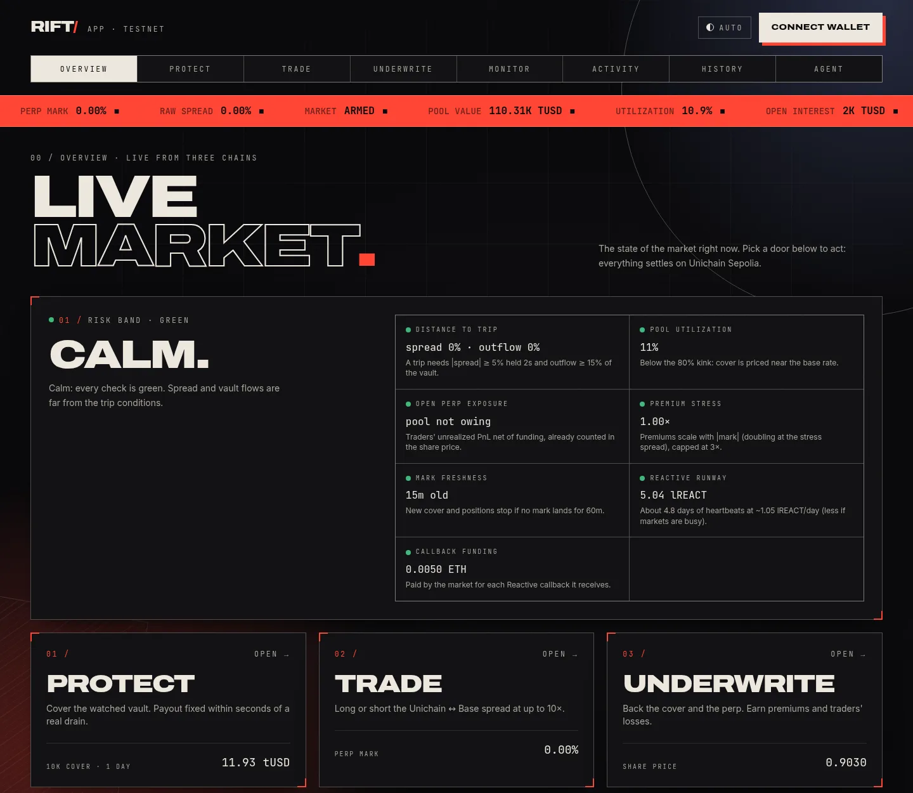

# Rift: bridge-failure cover that pays in seconds

**Track:** Every Second Counts · **Live app:** [rift-bice.vercel.app](https://rift-bice.vercel.app) · **Code:** [github.com/Diam0naz/rift](https://github.com/Diam0naz/rift)

## The problem

When a bridge is drained, the tokens it minted on other chains lose their backing and crash, and their holders can't sell their way out. Existing DeFi cover depends on someone judging the claim, which takes days to weeks, long after the damage is done.

We replayed the 2022 Nomad exploit from public chain data to measure this. Nomad-bridged USDC on Moonbeam went from $0.9995 to $0.045 in about a minute. That happened before a single USDC had left the bridge's escrow on Ethereum, and the only exit pool then paid about 2 cents. What holders needed was a payout they could count on, fixed the moment the failure is real, from a pool funded in advance.

## How it works

Rift reads one signal across chains: the **spread** between the same asset's markets on two chains, plus **outflows from a vault**, such as a bridge's escrow.

1. **RiftReactive** (Reactive Network) subscribes to pool `Sync` events on both chains and to the vault's `Transfer` events. It computes the spread and a 5-minute outflow window on every event, plus a cron heartbeat.
2. Every meaningful spread change is sent to **RiftMarket** (Unichain) as a mark via callback. That's what the perp trades on.
3. When **both** conditions hold (|spread| ≥ 5% sustained for 2 s **and** ≥ 15% of the vault gone within 5 minutes), RiftReactive sends `trip`. That one callback fixes every covered payout and freezes the perp. Buyers then `claim()`; nobody judges anything.

A price move alone, or a large withdrawal alone, never pays. Manipulating a thin pool doesn't trip it.

**Proof on testnet, live.** On 24 Nov 2026 one simulated drain of a vault on Base Sepolia tripped two markets on Unichain Sepolia in the same block, about 2 seconds after the drain: Rift's own market, and a market a trader had listed through the factory, with cover on that vault. Every covered policy was paid in full. Hashes for every leg are [below](#a-live-trip-of-two-markets-24-nov-2026).

**Proof on real data.** Replaying the Nomad exploit from Ethereum and Moonbeam chain history, Rift's rule trips at 22:46:36 UTC with **$71.2M of the $87.5M USDC escrow still in place**, 65 minutes before it was emptied. The scripts are in [`research/`](https://github.com/Diam0naz/rift/tree/main/research), and anyone can re-run them.

## Key features

- **Protect (drain cover):** buy cover on a watched vault, with an exact quote. The premium prices utilization and stress. Coverage starts after a waiting period, so nobody can buy cover once a drain is already visible. Payouts are fixed in the trip transaction.
- **Trade (spread perp):** long or short the cross-chain spread at up to 10×, with funding every second. Settles on the time-weighted mark; liquidation pays a reward.
- **Underwrite:** deposit into the pool that sells cover and takes the other side of every perp trade. Shares are priced on the pool's real value, withdrawals take two steps with a 1-hour delay, and capital backing live cover is reserved.
- **AI agent (Gemini default, Claude as a paid tier):**
  - **co-pilot:** it reads live state, explains, quotes, and proposes transactions you sign;
  - **autopilot:** it acts from your **RiftAgentVault**, where the contract enforces your limits (daily spend, size, leverage, allowed actions, and a fee cap for paying the agent);
  - **background rules:** stop-loss, take-profit, liquidation guard, auto-claim, auto-hedge, and plain-language goals.
- **Markets (open your own):** anyone lists a spread market on any two pools of the same pair, on Base, Unichain or Ethereum Sepolia (Uniswap v2, Uniswap v3 or RiftPool). One factory deploys the market; one Reactive contract, **RiftHub**, picks the listing up from its event and subscribes to both pools from inside `react()`. Nothing new is deployed on Reactive per market.
- **Cover on a listing:** the lister can propose drain cover on any vault, with its own trip rule. Once Rift approves it, RiftHub subscribes to that vault's transfers and to the market's `Tripped` event, then arms the market with a callback; cover is only sold after that handshake lands. The hub trips each market on the same two-condition rule, re-sends the trip until the market confirms it, then drops every subscription of that market.
- **Scanner:** paste any two pools (Uniswap v2, Uniswap v3 or RiftPool) on Base, Unichain or Ethereum Sepolia to see their live prices and the gap between them. It only reads prices, and it shows which pair could become the next market.
- **Monitor and History:** the whole path from Base origin to Lasna reaction to Unichain settlement, with timings, from an indexer that follows all three chains.

## Why Reactive Omni

The signal lives on two chains, and the vault lives on one of them. No single contract can see both, and polling would be both slower and trusted. RiftReactive is the only thing that connects them, and it settles in seconds. Measured on testnet across the full loop (origin event → Lasna reaction → Unichain callback): **swap on Base → mark on Unichain in ~3 s; vault drain → every payout fixed in ~2 s.**

RiftHub goes further: its subscriptions change at runtime. A listing event makes it subscribe to two new pools; an approval event makes it subscribe to a vault and to the market's confirmation; a confirmed trip makes it unsubscribe. Subscriptions are shared and reference-counted across markets, and a pool that fires too often is throttled so one busy pool can't drain the hub's REACT.

## Tech stack

- **Contracts:**
  - Solidity 0.8.30 with Foundry and OpenZeppelin;
  - Reactive Network Omni: system contract subscriptions, `react()`, callback proxy, Cron1000 heartbeat.
- **Chains:** Base Sepolia (origin: pool and vault), Reactive Lasna (RiftReactive), Unichain Sepolia (RiftMarket, agent vaults).
- **App:**
  - Next.js 16, React 19, Tailwind 4;
  - viem, wagmi 2 and RainbowKit for wallets;
  - TanStack Query for data.
- **Agent:** Google Gemini (`@google/genai`) and Anthropic Claude (`@anthropic-ai/sdk`), with a tool loop over live chain state.
- **Data:** an indexer for all three chains, running on Node with Neon Postgres and hosted on Render.
- **Hosting:** Vercel. The autopilot runs on a GitHub Actions schedule.
- **Quality:** 99 tests, including invariant fuzzing, a fork replay of the real testnet trip, and 37 tests of the factory, hub and trader markets (cover arming, the two-condition trip, retries, a 32-policy trip within the callback's gas limit). Slither reports 0 results on `src/`; in RiftHub and RiftSpreadMarket, the findings it raised were reviewed and each one is suppressed inline with its reason (calls to Reactive's trusted system contract, a false positive on a mapping of arrays, a deliberate divide-before-invert on 1e36-scaled prices, two address checks the factory makes redundant). A 16-step browser test drives every screen on a fork.

## Hackathon requirements

**Deployed contracts**

| Contract | Chain | Address |
|---|---|---|
| RiftReactive | Reactive Lasna | [`0xAD0983eBF145C8f8184bf219E795aC63fEE58B78`](https://lasna.reactscan.net/address/0xAD0983eBF145C8f8184bf219E795aC63fEE58B78) |
| RiftMarket | Unichain Sepolia | [`0x45c96DC6c9f5C5A8CFe0Ac8B88DCD7F49b16Bcb0`](https://sepolia.uniscan.xyz/address/0x45c96DC6c9f5C5A8CFe0Ac8B88DCD7F49b16Bcb0) |
| RiftAgentVaultFactory | Unichain Sepolia | [`0x390232484C2873945a1Dc1425370Ef3080495b8B`](https://sepolia.uniscan.xyz/address/0x390232484C2873945a1Dc1425370Ef3080495b8B) |
| RiftPool | Unichain Sepolia | [`0x3bE5C66453dB2b55412Bf96b4F2df46F34e239ce`](https://sepolia.uniscan.xyz/address/0x3bE5C66453dB2b55412Bf96b4F2df46F34e239ce) |
| RiftPool | Base Sepolia | [`0xA5aB34c37F2d8C8f86a32BA007F6e421D0B5315D`](https://sepolia.basescan.org/address/0xA5aB34c37F2d8C8f86a32BA007F6e421D0B5315D) |
| MockVault (watched vault) | Base Sepolia | [`0xCC83d90035bea5b69d3358479F046781146353e3`](https://sepolia.basescan.org/address/0xCC83d90035bea5b69d3358479F046781146353e3) |
| RiftHub (marks and trips every listed market) | Reactive Lasna | [`0xe95abe092d49cBD81FAC9F5BDeD954806a14BF09`](https://lasna.reactscan.net/address/0xe95abe092d49cBD81FAC9F5BDeD954806a14BF09) |
| RiftMarketFactory | Unichain Sepolia | [`0x5366d86d51787a157E25739CCdfcf41CBD35381b`](https://sepolia.uniscan.xyz/address/0x5366d86d51787a157E25739CCdfcf41CBD35381b) |
| Market #0, trader-listed, cover on MockVault (tripped) | Unichain Sepolia | [`0xaa0Ae0b200aB3Ef3AfB4cA07aEb263e4C52b6d05`](https://sepolia.uniscan.xyz/address/0xaa0Ae0b200aB3Ef3AfB4cA07aEb263e4C52b6d05) |
| Market #1, the same pair listed again, cover on sale | Unichain Sepolia | [`0x81Af29C5DE30cfF213d5653682E22ff2739EE21b`](https://sepolia.uniscan.xyz/address/0x81Af29C5DE30cfF213d5653682E22ff2739EE21b) |

**The full Reactive loop, on testnet**

| Loop | Origin (Base) | Reaction (Lasna) | Callback (Unichain) | Latency |
|---|---|---|---|---|
| Mark update | [`0xc2b7e42a…`](https://sepolia.basescan.org/tx/0xc2b7e42a455f552976787d6db6f694bbdede8344b2d15101161b166954686211) | [`0xb98be7f1…`](https://lasna.reactscan.net/tx/0xb98be7f1893c3098ea95dc76384f7ce8d776e1dc11848a604e0f865bca68ecea) | [`0x60f12571…`](https://sepolia.uniscan.xyz/tx/0x60f12571f05d83fa4831517c27fecb121e38ecb6c4c976c2dc0b96402aff77ea) | ~3 s |
| Drain → trip | [`0x443b4c59…`](https://sepolia.basescan.org/tx/0x443b4c59ce762b180c7828dc5fc77011d61c07cb4b20202bf597006c32f2dcf6) | [`0xe46d223e…`](https://lasna.reactscan.net/tx/0xe46d223e4e394afa5f28797659bb2db8f2d6c42f0ea1b5c41289cb572b8316ed) | [`0x12babcb0…`](https://sepolia.uniscan.xyz/tx/0x12babcb0e4c12e8d297f0ba01dca2659c261780779281c1b24c11accaec5a9c4) | ~2 s |

The trip settled a 10,000 tUSD policy at 100%, and it was claimed in [`0xe2190ea1…`](https://sepolia.uniscan.xyz/tx/0xe2190ea1ed408063a07b6b94e2cda6ec4e58ffcca9d02e4a2d109575ce545b41).

### A live trip of two markets (24 Nov 2026)

The vault was drained on Base in [`0xb59a5add…`](https://sepolia.basescan.org/tx/0xb59a5add636e45111fd5d7962c685b5ca4797c9f9ffe4d22b188ac9a06719de7) (300k of 700k) and the loot dumped into the Base pool in [`0x05e8c109…`](https://sepolia.basescan.org/tx/0x05e8c1093c576e411a00327ab83b8e6b8b5670bf84bac866bbd8cedb6abb595f), breaking the spread. The next vault transfer, [`0x09bf3e64…`](https://sepolia.basescan.org/tx/0x09bf3e645abc2ce6fc705fec9e052037b0f81314b68e8f9725957c378fbad869), found both conditions held and tripped both markets:

| Market | Origin (Base) | Reaction (Lasna, block 9126850) | Trip callback (Unichain, block 68660191) | Claim |
|---|---|---|---|---|
| RiftMarket, via RiftReactive | [`0x09bf3e64…`](https://sepolia.basescan.org/tx/0x09bf3e645abc2ce6fc705fec9e052037b0f81314b68e8f9725957c378fbad869) | [`0x94a61004…`](https://lasna.reactscan.net/tx/0x94a61004e9e37dad6bde4564ab2504519233e1795b51818d421a416482ba7cba) | [`0xfc12853d…`](https://sepolia.uniscan.xyz/tx/0xfc12853dc8236e6a3dab9be0a84de294d5d7ae6a79d55fbbde42d4ee16ac1abc) | [`0xc878afd3…`](https://sepolia.uniscan.xyz/tx/0xc878afd31255204a20c4088ae6d4e995a9deda8e388569ac2d12ce5b8d9710e3) |
| Market #0 (trader-listed), via RiftHub | same | [`0xf7edddc2…`](https://lasna.reactscan.net/tx/0xf7edddc2fe44e21d788aaff549b274299f6257ccd9672e88a0bc9a3caaca1464) | [`0x180fc9e6…`](https://sepolia.uniscan.xyz/tx/0x180fc9e6b79d6aabb2147b69721be3ecf9168ff4f4149efc85e2aa34781974af) | [`0x980e3955…`](https://sepolia.uniscan.xyz/tx/0x980e3955cf6bef7c8117d5d1d4ff03517939a4fd93db7887608c05e07366bb85) |

- **Latency, full loop:** Base block at 09:30:17 UTC (1795512617) → both reactions in one Lasna block → both trips in one Unichain block at 1795512619: **about 2 s**. The chains' clocks differ by about a second, which is why Lasna's timestamp reads one second before Base's.
- **Trip values:** −74.87% spread, 42.85% vault outflow, recorded identically by both markets.
- **Payouts:** a 10,000 tUSD policy on each market paid 10,000 (premiums 11.93 and 11.25 tUSD). A 5,000 tUSD short on market #0 closed at the trip mark for +3,743.50 on 1,000 of margin.
- **After the trip:** RiftHub received market #0's `Tripped` event, marked the trip confirmed and dropped all of that market's subscriptions. The pair was then listed again as market #1, and its cover was armed by the hub within seconds of approval.

**Demo video:** _add your link here_ (80 s; the file is [`brag-output/rift-pitch.mp4`](https://github.com/Diam0naz/rift/blob/main/brag-output/rift-pitch.mp4))

**Scope, honestly:** this is a testnet demo with mock twin pools and a mock vault. Cover on a trader's listing needs Rift's approval, because whoever controls a vault and two thin pools could otherwise trip their own cover; that approval is a single key today. The design targets bridge escrows and bridged assets, where the spread *is* the holders' loss. The README's "Strengths and scope" section marks each limit as inherent or current, with what improves it.
